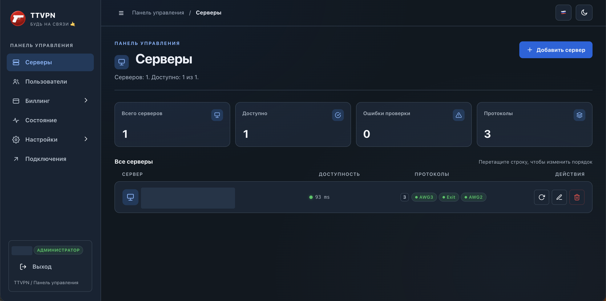
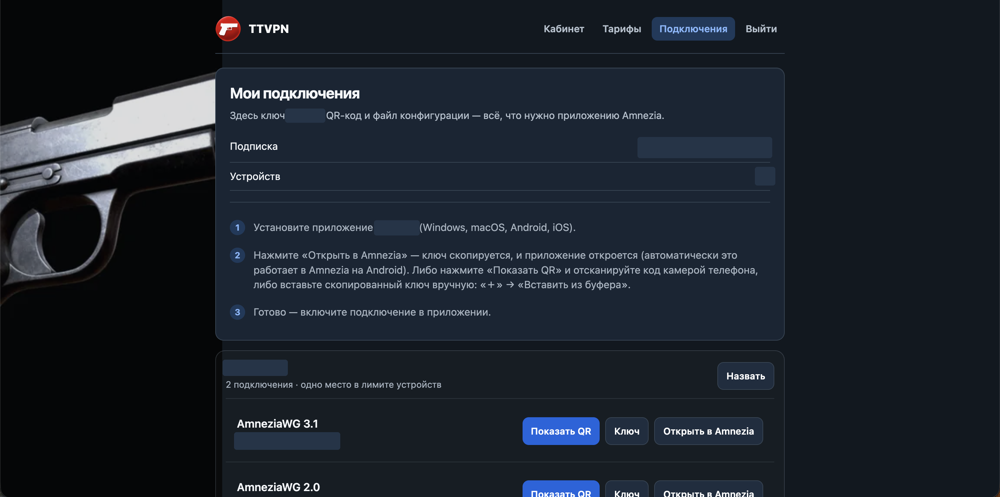

# TTVPN

TTVPN — веб-панель для управления VPN-инфраструктурой, пользователями и подписками. Проект основан на [Amnezia Web Panel](https://github.com/PRVTPRO/Amnezia-Web-Panel) и сохраняет возможности исходной панели там, где это возможно.

## Скриншоты

Ниже — реальные снимки интерфейса TTVPN. Адреса, идентификаторы и сведения подписки скрыты; интерфейс может измениться после создания снимков.

### Управление серверами



### Подключения в личном кабинете



На снимках намеренно скрыты данные сервера и подписки.

## Возможности

- Управление серверами и VPN-протоколами, включая AmneziaWG, WireGuard и Xray.
- Профили подключений и отдельные конфигурации для устройств.
- Личный кабинет, тарифы, подписки и интеграция с ЮKassa при настройке платёжного магазина.
- Telegram-бот и уведомления при соответствующей настройке.
- Страница состояния системы и изолированный мониторинг панели, прокси, Telegram-бота и доступности SSH-портов VPN-нод. Проверка SSH-порта **не подтверждает**, что VPN у клиентов работает.
- ИИ-помощник в личном кабинете и анализ показателей монитора по запросу администратора. Поддерживаются OpenAI, RouterAI и Groq; необходимы ключ, доступная модель и сетевое подключение к провайдеру. ИИ может ошибаться и не выполняет автоматическое исправление системы.
- Дополнительные средства исходной панели: DNS, прокси, почта, резервное копирование и работа с нодами выхода. Доступность зависит от настроек, версии и окружения.

Отдельные функции, включая каскадные подключения и платёжную интеграцию, требуют дополнительной инфраструктуры и настройки. Наличие кода не означает, что конкретная функция настроена или проверена для вашего сервера.

## Как скачать

На странице репозитория нажмите **Code → Download ZIP** и распакуйте архив. Либо выполните в терминале:

```bash
git clone https://github.com/titos94/TTVPN.git
cd TTVPN
```

## Сборка и установка

Для сборки образа из кода потребуется Docker:

```bash
docker build -t ttvpn:local .
```

Эта команда **только собирает образ**. Универсальный автоматический установщик TTVPN ещё не подготовлен и не проверен. Перед развёртыванием необходимы настройка постоянного хранилища, секретов, учётной записи администратора, HTTPS, сетей, монитора и резервного копирования.

> **Важно:** файл `docker-compose.yml` по умолчанию ссылается на образ исходного проекта `prvtpro/amnezia-panel:latest`, а не собирает образ TTVPN из этого репозитория. Не используйте его как инструкцию установки TTVPN. `docker-compose.prod.yml` также рассчитан на подготовленное окружение и не является универсальным установщиком.

Исходный код использует Python, FastAPI, Jinja2, JavaScript и Paramiko. В поставляемом `Dockerfile` используется Python 3.14. Серверы для управления должны быть доступны по SSH; перед подключением необходимо независимо проверить и подтвердить SSH host key.

## Настройка ИИ

В админке откройте **Настройки → Искусственный интеллект**, выберите провайдера, укажите его API-ключ и доступную вашему проекту модель. Сохраните настройки и проверьте подключение. При смене провайдера требуется новый ключ.

Проверка подключения может подтвердить доступ к API, но не гарантирует право использовать конкретную модель. Для диагностики откройте **Состояние → Проанализировать состояние**. На анализ передаются ограниченные обезличенные показатели, а не VPN-ключи или учётные данные. Не отправляйте секреты и персональные данные в клиентский чат; проверьте условия обработки данных у выбранного провайдера. Задайте финансовые лимиты у провайдера: ограничение количества запросов в панели не является денежным лимитом.

## Безопасность и резервные копии

- Не публикуйте `.env`, `data.json`, `billing.db`, VPN-ключи, SSH-ключи, токены и архивы данных.
- Используйте уникальный надёжный `SECRET_KEY`, ограничивайте доступ к панели и применяйте HTTPS.
- Храните постоянные данные и согласованные резервные копии отдельно от контейнера; проверяйте возможность восстановления.
- Перед изменениями на работающем сервере сохраняйте текущий образ и данные. Не восстанавливайте старую базу поверх новых платежей или подключений без отдельной проверки.
- Операции установки, удаления и перенастройки VPN-сервисов могут повлиять на действующие подключения. Выполняйте их только после проверки и резервного копирования.

## Документация и участие

Подробности о биллинге, SSH, резервном копировании и отдельных компонентах находятся в файлах репозитория. Некоторая документация может относиться к исходной панели или ещё не быть переведена на русский язык; сверяйте её с текущим кодом.

Сообщения об ошибках и предложения можно отправлять через Issues и Pull Requests. Пожалуйста, не прикладывайте секреты, данные клиентов и реальные конфигурации подключений.

## Лицензия и исходный проект

Проект распространяется по [GNU General Public License v3.0](LICENSE). В основе лежит [PRVTPRO/Amnezia-Web-Panel](https://github.com/PRVTPRO/Amnezia-Web-Panel); права на сторонние приложения, библиотеки и товарные знаки принадлежат их владельцам. Используйте программное обеспечение с соблюдением применимого законодательства.
